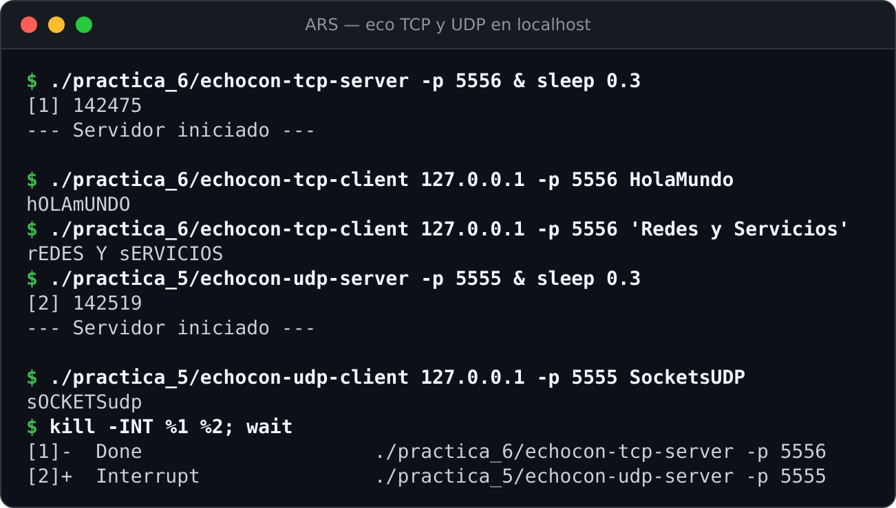

<div align="center">

# Sockets en C: UDP, TCP, TFTP e ICMP

**Clientes y servidores de red escritos desde cero en C sobre la API de sockets POSIX: eco UDP y TCP, un servidor concurrente, un cliente TFTP y un `ping` propio con sockets RAW.**


<sub>Arquitectura de Redes y Servicios · Grado en Ingeniería Informática · Universidad de Valladolid · Curso 2023-2024</sub>

</div>

<p align="center">
  
  <br>
  <sub>Salida real del programa.</sub>
</p>

## En pocas palabras

- **Reto**: implementar servicios de red reales trabajando directamente con sockets, sin bibliotecas de alto nivel, y entender qué viaja por la red en cada protocolo.
- **Solución**: seis programas en C para Linux: eco sobre UDP y TCP (cliente y servidor), un servidor TCP concurrente, un cliente TFTP con lectura y escritura de ficheros y una implementación de `ping` con ICMP sobre sockets RAW.
- **Demuestra**: programación de red a bajo nivel, construcción manual de cabeceras y paquetes de protocolo, concurrencia con procesos, gestión de señales y control de errores de llamadas al sistema.

## Lo más destacado

- **Servidor TCP concurrente**: cada conexión aceptada se atiende en un proceso hijo creado con `fork()`; un manejador de `SIGINT` cierra los sockets al pulsar Ctrl+C y `SO_REUSEPORT` evita `bind(): Address already in use` al reiniciar.
- **Cliente TFTP completo**: construye a mano las peticiones RRQ/WRQ, transfiere bloques de 512 bytes, comprueba el orden de bloques y ACK y trata los datagramas `ERROR` del servidor.
- **`ping` con sockets RAW**: rellena la cabecera ICMP (tipo, código, PID, número de secuencia), calcula el *checksum* y traduce los errores ICMP (por ejemplo, *Destination Unreachable*) a mensajes legibles.
- **Compila limpio**: los seis programas compilan sin avisos con `gcc -Wall`, y el eco UDP y TCP se ha probado en local (captura de arriba).
- **Programas robustos**: validación de argumentos con mensaje de uso en cada programa y `perror()` en todas las llamadas al sistema.

## Competencias

| Área | Qué se aplicó |
|------|---------------|
| Redes | UDP, TCP, TFTP e ICMP; `SOCK_DGRAM`, `SOCK_STREAM`, `SOCK_RAW` |
| Protocolos a bajo nivel | Formato de paquetes RRQ/WRQ/DATA/ACK/ERROR y cabeceras ICMP con *checksum* |
| Sistemas | Procesos con `fork()`, señales (`SIGINT`), opciones de socket |
| Calidad | Compilación sin avisos con `-Wall`, control de errores sistemático |

## Qué contiene

| Práctica | Programa | Descripción |
|----------|----------|-------------|
| [Tema 5](practica_5/) | `echocon-udp-client` / `echocon-udp-server` | Servicio de eco sobre UDP: el servidor devuelve la cadena con mayúsculas y minúsculas invertidas. |
| [Tema 6](practica_6/) | `echocon-tcp-client` / `echocon-tcp-server` | El mismo servicio sobre TCP, con un servidor concurrente (un proceso hijo por cliente). |
| [Tema 7](practica_7/) | `tftp-client` | Cliente TFTP que descarga (`-r`) o sube (`-w`) ficheros en modo `octet`, con salida detallada opcional (`-v`). El puerto se obtiene con `getservbyname("tftp", "udp")`. |
| [Tema 8](practica_8/) | `miping` | Envío de un ICMP *Echo Request* con sockets RAW e interpretación de la respuesta y de los mensajes de error ICMP. Usa la cabecera `ip-icmp-ping.h` que da el profesorado. |

Las carpetas `practica_5` y `practica_6` incluyen además el enunciado y la estructura básica de un programa UDP/TCP en PDF.

## Estructura del repositorio

```text
ARS/
├── practica_5/   # Eco UDP (cliente y servidor) + enunciado
├── practica_6/   # Eco TCP (cliente y servidor concurrente) + enunciado
├── practica_7/   # Cliente TFTP
└── practica_8/   # miping (ICMP con sockets RAW) + ip-icmp-ping.h
```

## Requisitos

- Linux (o WSL) con `gcc`
- Permisos de superusuario para `miping`, porque abre un socket RAW
- Un servidor TFTP accesible para probar `tftp-client`

## Cómo ejecutarlo

<details>
<summary>Compilación de los seis programas</summary>

```bash
git clone https://github.com/JavivuG/ARS.git
cd ARS

# Los nombres de los ejecutables coinciden con los del .gitignore
gcc -Wall -o practica_5/echocon-udp-server practica_5/echocon-udp-server-GarciaGonzalez.c
gcc -Wall -o practica_5/echocon-udp-client practica_5/echocon-udp-client-GarciaGonzalez.c
gcc -Wall -o practica_6/echocon-tcp-server practica_6/echocon-tcp-server-GarciaGonzalez.c
gcc -Wall -o practica_6/echocon-tcp-client practica_6/echocon-tcp-client-GarciaGonzalez.c
gcc -Wall -o practica_7/tftp-client       practica_7/tftp-client-GarciaGonzalez.c
gcc -Wall -o practica_8/miping            practica_8/miping-GarciaGonzalez.c
```

</details>

<details>
<summary>Uso de cada programa</summary>

```bash
./echocon-udp-server [-p puerto-servidor]
./echocon-udp-client ip_servidor [-p puerto-servidor] cadena

./echocon-tcp-server [-p puerto-servidor]
./echocon-tcp-client ip_servidor [-p puerto-servidor] cadena

./tftp-client ip_servidor {-r|-w} archivo [-v]

sudo ./miping ip_servidor [-v]
```

</details>

Ejemplo rápido en local:

```bash
./practica_5/echocon-udp-server -p 5555 &
./practica_5/echocon-udp-client 127.0.0.1 -p 5555 HolaMundo   # -> hOLAmUNDO
```

## Estado y limitaciones

- El eco UDP y TCP se ha probado en local. El cliente TFTP y `miping` no se han probado al preparar este README, porque necesitan un servidor TFTP y permisos de superusuario.

## Autoría

Javier García González.

---

<div align="center"><sub>Parte de <a href="https://github.com/JavivuG/UVa-Projects">UVa-Projects</a> · Javier García González</sub></div>
